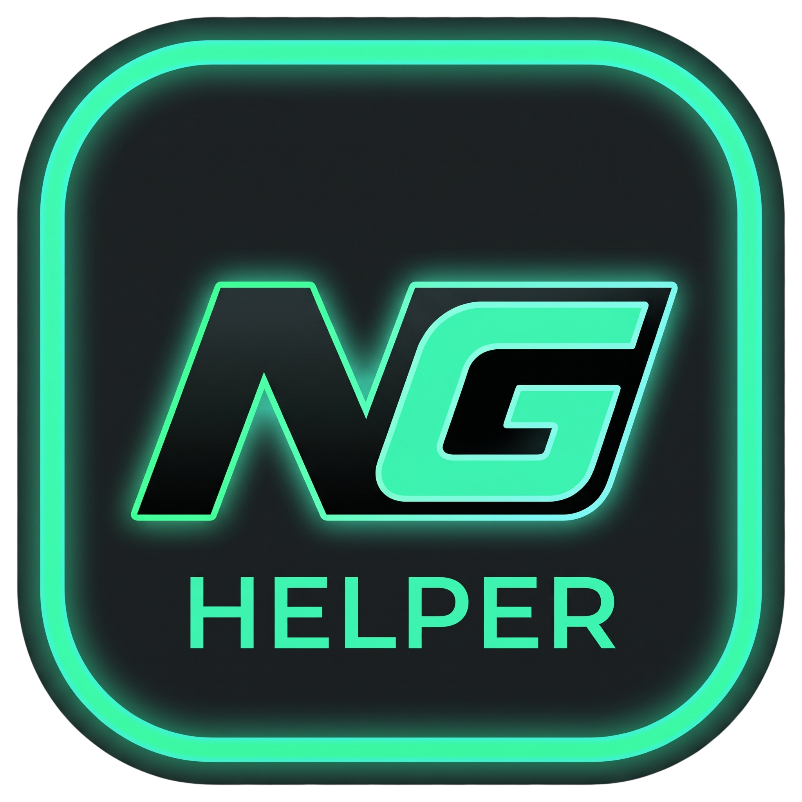
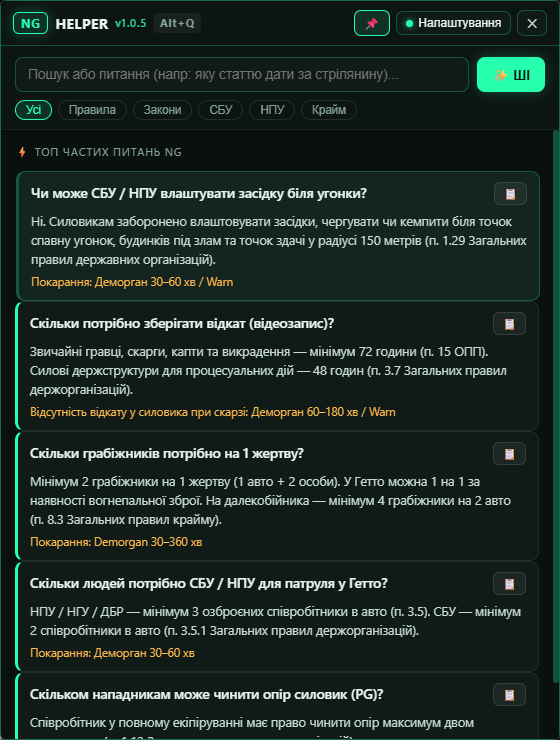
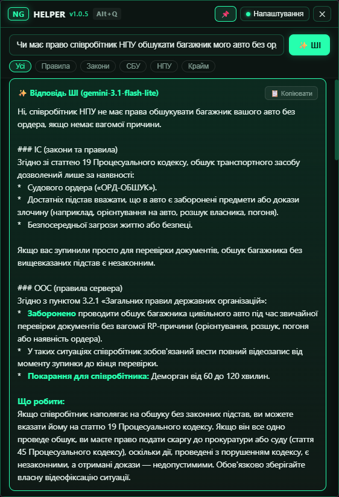
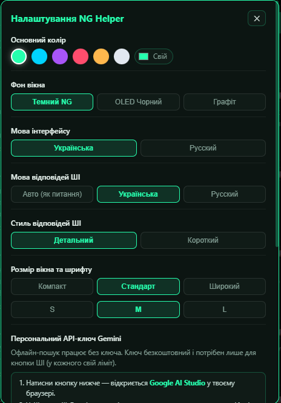
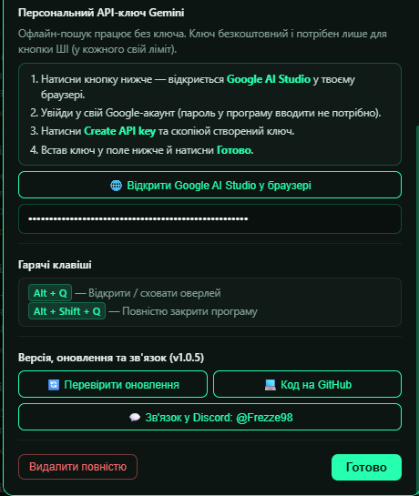

<h1>NG Helper</h1>

  <b>Ігровий оверлей для GTA 5 RP (проєкт NG)</b> 
  Офлайн-пошук по базі правил, законів і статутів + розбір RP-ситуацій через ШІ (Gemini) поверх гри.

  
  
  

  
  
  

---

## Скріншоти

<table>
  <tr>
    <td align="center" width="50%">
       
      <b>Офлайн-пошук, фільтри та «Топ частих питань NG»</b>
    </td>
    <td align="center" width="50%">
       
      <b>Розбір RP-ситуацій через ШІ (IC + OOC + поради)</b>
    </td>
  </tr>
  <tr>
    <td align="center" width="50%">
       
      <b>Теми, акцентні кольори, мова та розмір вікна</b>
    </td>
    <td align="center" width="50%">
       
      <b>API-ключ, гарячі клавіші, автооновлення та видалення</b>
    </td>
  </tr>
</table>

---

## Основні можливості

- **Миттєвий виклик у грі:** відкриття та приховування оверлею по `Alt + Q`, фіксація поверх вікна гри (`📌`).
- **Офлайн-пошук без інтернету та ключів:** швидка навігація по вбудованій базі (понад **85 документів** та **2 300 розділів і статей**) з фільтрами `Усі`, `Правила`, `Закони`, `СБУ`, `НПУ`, `Крайм`.
- **Топ частих питань NG:** готові картки з найпопулярнішими правилами та термінами покарань із копіюванням в 1 клік.
- **ШІ-помічник (Gemini):** аналізує живу ситуацію за актуальною базою проєкту та розкладає відповідь на **IC (кодекси й закони)**, **OOC (правила сервера)** і конкретні дії.
- **Гнучка персоналізація:** 6 готових акцентних кольорів + власний колір, 3 теми фону (`Темний NG`, `OLED Чорний`, `Графіт`), вибір мови інтерфейсу та відповідей ШІ (`Українська` / `Русский`), стилю відповідей (`Детальний` / `Короткий`), розміру вікна й шрифту.
- **Зручне обслуговування:** вбудована перевірка й автооновлення з GitHub Releases, робота в треї та повне видалення однією кнопкою з налаштувань.

<b>Що входить у вбудовану офлайн-базу правил (натисни, щоб розгорнути)</b>

- **Правила проєкту NG (17 документів):** Офіційні правила проєкту, правила держорганізацій, допитів, лідерів, крайму, лор та заходи крайму, захоплення держорганізацій, воєнний стан, поставки, рейди, напад на ФЗ (НГУ), AirDrop, ВЗХ, ігрові зони, RP-біографії, сімейні організації.
- **Законодавство штату NG:**
  - Конституція штату NG
  - **7 Кодексів:** Кримінальний, Адміністративний, Процесуальний, Трудовий, Етичний, Повітряний, Дорожній
  - **18 Законів штату NG:** про адвокатуру, ДБР, державні документи, ДВВ, ДВК, держтаємницю, закриті території, воєнний стан, НГУ, НПУ, недоторканність, прокуратуру, охорону здоров'я (ЕМД), полювання та рибальство, зброю, СБУ, судоустрій, медіа
- **Статути та регламенти 8 фракцій:** НПУ, НГУ, СБУ, ДБР, ДВК, ЕМД, ТСН, ДВВ.

---

## Встановлення та запуск

1. Перейди у розділ [Releases](https://github.com/Frezze98/ng-helper/releases/latest) і завантаж **`Setup-NG-Helper.exe`**.
2. Запусти інсталятор, обери мову та за бажанням увімкни створення ярлика на робочому столі й автозапуск разом із Windows.
3. Запусти **NG Helper** — натискай `Alt + Q`, щоб миттєво відкрити або сховати оверлей.

> [!TIP]
> Щоб оверлей відображався поверх GTA 5, у налаштуваннях графіки гри має бути обрано режим **«Вікно без рамок» (Borderless Window)** або **«У вікні»**.

### Гарячі клавіші

| Дія | Керування |
| :--- | :--- |
| Відкрити / сховати оверлей | `Alt + Q` або клік ЛКМ по іконці в треї |
| Повністю закрити програму | `Alt + Shift + Q` або меню трею |
| Перемістити вікно | Перетягування за верхню шапку |

---

## Як отримати безкоштовний API-ключ Gemini

Офлайн-пошук і «Топ частих питань» працюють **одразу без жодного ключа**. Персональний ключ потрібен лише для кнопки **«ШІ»** (у кожного користувача свій безкоштовний ліміт, пароль від Google у програму вводити не потрібно):

1. Відкрий **Налаштування** в оверлеї та натисни **«Відкрити Google AI Studio у браузері»** (або перейди на [aistudio.google.com/apikey](https://aistudio.google.com/apikey)).
2. Увійди у свій Google-акаунт.
3. Натисни **Create API key**, скопіюй ключ, встав його у поле в налаштуваннях і натисни **Готово**.

---

## Безпека, VirusTotal та Windows SmartScreen

- **Відкритий код:** усі вихідні файли відкриті у цьому репозиторії.
- **Автоматична збірка:** інсталятор `Setup-NG-Helper.exe` компілюється не на локальному ПК, а автоматично на серверах **GitHub Actions** (див. `.github/workflows/release.yml`).
- **Перевірка VirusTotal (`v1.0.5`):** [відкрити звіт для `Setup-NG-Helper.exe`](https://www.virustotal.com/gui/file/c49c1157725623b1368c9a36c5b0f549aafc50cdea2d9ee59accd0a2919cdb01)
  - `SHA-256`: `c49c1157725623b1368c9a36c5b0f549aafc50cdea2d9ee59accd0a2919cdb01`

> [!NOTE]
> **Чому Windows може показати синє вікно «ОС Windows захистила цей ПК»?**
> Це стандартна реакція **Microsoft Defender SmartScreen** на нові безкоштовні open-source програми без платного комерційного сертифіката підпису коду (`Невідомий видавець`). Файл уже надіслано на перевірку в **Microsoft Security Intelligence**. Щоб запустити інсталятор, натисни **«Детальніше»** → **«Виконати все одно»**.

<b>Де зберігаються налаштування та як повністю видалити програму?</b>

- **Налаштування, кеш WebView2 та логи помилок (`error.log`):** `%LOCALAPPDATA%\NGHelper`
- **Файли програми:** `%LOCALAPPDATA%\Programs\NG Helper`
- **Видалення:** відкрий **Налаштування** → натисни **«Видалити повністю»** (або видали через стандартне меню *«Програми та засоби»* Windows).

---

## Контакти

- **Discord:** `@Frezze98`
- **GitHub:** [github.com/Frezze98/ng-helper](https://github.com/Frezze98/ng-helper)
